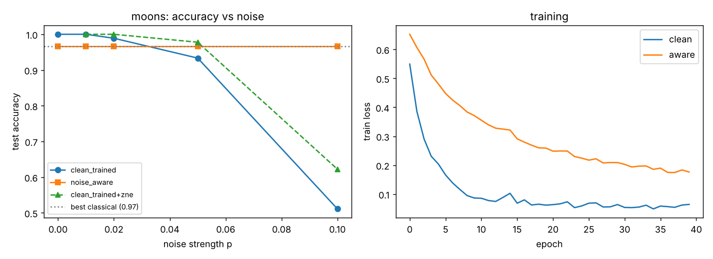
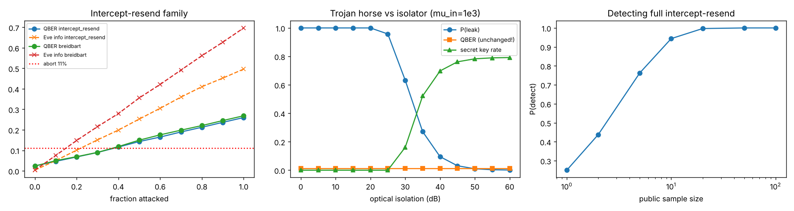

# BreaQ 2026 — Quantum AI & Quantum Hacking toolkit

Team repo for the [BreaQ Hackathon 2026](https://roqteam.ro/breaq-hackathon.html)
(24–25 Oct, CAMPUS Research Institute, Bucharest).

## Quick start
```powershell
python -m venv .venv
.venv\Scripts\Activate.ps1      # macOS/Linux: source .venv/bin/activate
python run.py install
python run.py check             # prints READY when everything is installed
python run.py test              # 23 tests, ~15s
python run.py qai-fast          # quantum classifier under noise, ~15s
python run.py qhack             # BB84 attacks, ~1s
python run.py summary
```
(`make` targets with the same names exist for macOS/Linux.)

## Quantum AI — variational classifier under realistic noise (PennyLane)
Hybrid VQC with data re-uploading, a configurable noise model (depolarizing, two-qubit
depolarizing, amplitude/phase damping, readout), noise-aware training, noise-scaling
extrapolation (ZNE) and classical baselines with parameter counts.

Pre-hackathon result (moons, 4 qubits × 3 layers, 40 params; `python run.py qai`):

| noise p | trained noiseless | trained under noise (p=0.05) | noiseless + ZNE |
|---|---|---|---|
| 0.00 | 1.000 | 0.967 | – |
| 0.02 | 0.989 | 0.967 | 1.000 |
| 0.05 | 0.933 | 0.967 | 0.978 |
| 0.10 | 0.511 | **0.967** | 0.622 |

Classical: logistic regression 0.911 (5 params), MLP[8] 0.867 (49), RBF-SVM 0.967.



Use your own data: `python -m qai.bench --dataset file:data/kit.csv --qubits 6`.

## Quantum Hacking — attacks on BB84 QKD
Exact numpy simulation of BB84 with sifting, public-sample QBER estimation, 11% abort
threshold and Shor-Preskill key rate; intercept-resend, Breidbart and Trojan-horse attacks
with an optical-isolator defence and detection statistics.



## Layout
`qai/` · `qhack/` · `tests/` · `docs/` (plan, pitch, log, kit digest) · `kit/` (starter kit)
· `.claude/skills/` (`/kickoff`, `/exp`, `/ship` for Claude Code) · `CLAUDE.md`.

## Limitations
Simulator only; noise channels are an idealised model, not a device calibration. ZNE here
scales channel strengths directly (on hardware: unitary folding).
